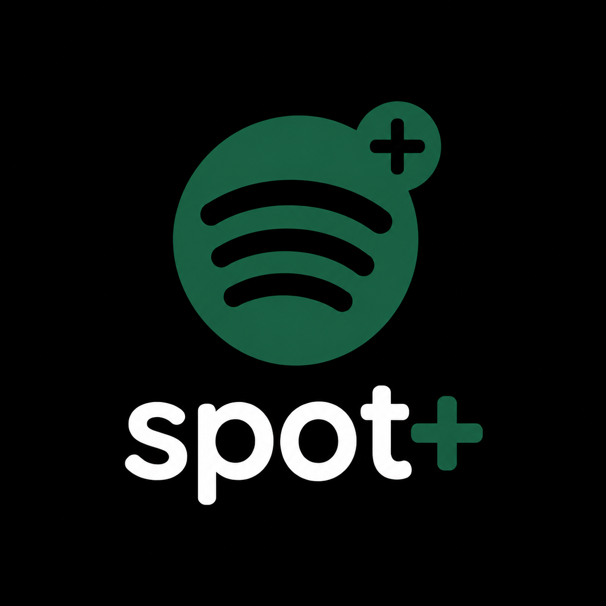
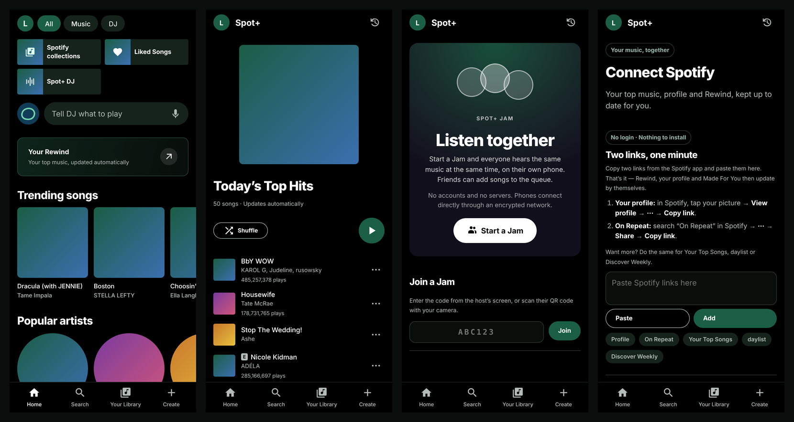

<div align="center">



# Spot+

**The free Spotify alternative and Spotify mod.** Spotify’s look and playlists in a free, installable app for phone and desktop, plus what Spotify doesn’t give you: Rewind stats anytime, Jams without Premium or accounts, and an on-device AI DJ.

[**Open Spot+ →**](https://coye2.github.io/spot-plus/)

[](https://github.com/coye2/spot-plus/actions/workflows/pages.yml)




<sub>Artwork is replaced with color tiles in these screenshots.</sub>

</div>

---

See what changed in each update: **[Changelog](CHANGELOG.md)**

## Highlights

| | |
|---|---|
| 🎧 **Full music player** | Search, queue, shuffle, repeat, lyrics, sleep timer, downloads, local files and lock-screen controls. |
| 🧩 **Spotify mod** | An optional helper adds a Spot+ panel to Spotify’s own web player that copies your Liked Songs and playlists into Spot+. |
| 🟢 **Spotify collections** | Charts, editorial, mood and decade playlists from Spotify, playable right in Spot+. Paste any playlist link to open it. |
| 📊 **Rewind** | Your top songs, artists, genres and listening clock, plus a shareable story. Connect Spotify by pasting two links; it then stays up to date without a login. |
| 👥 **Jam** | Listen together in sync on separate phones. Share a code or QR. No accounts, no servers, end-to-end encrypted. |
| 🎙️ **Spot+ DJ** | Talk or type to request music. Optional live mode runs a small AI model and voice entirely on your device. |
| 🎬 **Canvas loops** | Full-screen portrait video loops behind the player, like Spotify mobile. |
| 🎨 **Themes** | Light, dark and automatic modes, 19 color themes, true-black AMOLED, and status-bar colors that match. |
| 🔔 **Calm notifications** | New releases from artists you follow, a weekly recap and update alerts. Two a day at most, none at night. |
| 📱 **Works everywhere** | One web app for iPhone, Android, Windows, macOS and Linux. Installs like a native app and works offline. |

## Get started

Open **[coye2.github.io/spot-plus](https://coye2.github.io/spot-plus/)** and install it:

- **iPhone / iPad:** Safari → Share → **Add to Home Screen**
- **Android:** Chrome → menu → **Install app**
- **Computer:** Chrome or Edge → install icon in the address bar

A short welcome tour runs on first launch. Nothing to sign up for.

### Connect Spotify (optional, about a minute)

Profile → **Connect Spotify**, then paste two links from the Spotify app:

1. Your profile: tap your picture → **View profile** → **⋯** → **Copy link**
2. **On Repeat:** search it in Spotify → **⋯** → **Share** → **Copy link**

Rewind, your profile picture and Made For You then update by themselves. Optional extras, a browser helper for Liked Songs and a Spotify data download, are under *More ways to connect*. See the [helper guide](docs/spotify-helper.md).

## Privacy

- **No accounts, no tracking, no ads.** Your library, history and settings stay in your browser.
- Spot+ only reads **public** Spotify playlist and profile pages. It never asks for your Spotify password.
- Jams and synced stats are **encrypted on your device** before they travel through public relays.
- Back up or move your data anytime: Settings → **Export backup**.

## How it works

```
                 metadata   ┌──────────────────┐
              ┌───────────▶ │ Deezer           │  search, artists, albums
              │   audio     ├──────────────────┤
              ├───────────▶ │ Piped / Invidious│  matched full tracks
┌──────────┐  │   lyrics    ├──────────────────┤
│  Spot+   │──┼───────────▶ │ LRCLIB           │  synced lyrics
│  (PWA)   │  │   Spotify   ├──────────────────┤
└──────────┘  ├───────────▶ │ Spot+ bridge     │  public playlists, Canvas,
              │             │ (Cloudflare)     │  lyrics search
              │ Jam & sync  ├──────────────────┤
              └◀──────────▶ │ Nostr relays     │  encrypted, no accounts
                            └──────────────────┘
```

Spot+ is plain JavaScript modules with no framework. A service worker caches the app for offline use and instant startups. The production build minifies everything with esbuild.

## Development

Requires Node.js 20 or newer.

```sh
npm ci
npm run dev      # local server at http://127.0.0.1:8080
npm test         # unit tests (node --test)
npm run lint     # ESLint
npm run check    # project consistency checks
npm run build    # production build in dist/
```

Pushing to `main` builds and publishes to GitHub Pages automatically.

### Project layout

```
index.html, sw.js, manifest.webmanifest   app shell, offline cache, install info
js/              app modules (player, rewind, jam, spotify links, DJ…)
css/             styles; polish.css loads last
canvas-bridge/   Cloudflare Worker: Canvas, Spotify public pages, lyrics search
scripts/         build, dev server, checks, optional PowerShell helpers
tests/           node:test suites
docs/            guides, audit notes and screenshots
```

### Deploying the bridge

The worker in `canvas-bridge/` deploys automatically when the repository secrets `CLOUDFLARE_API_TOKEN` and `CLOUDFLARE_ACCOUNT_ID` are set. To deploy by hand:

```sh
cd canvas-bridge
npx wrangler login
npx wrangler deploy
```

## Known limits

- Full-length playback depends on public audio servers; when they're down, Spot+ falls back to 30-second previews.
- Notifications arrive while Spot+ is open or playing in the background, not when the app is fully closed.
- iOS Home Screen apps can show a thin strip at the bottom of the screen (an iOS 26 bug).
- Spotify playback, Spotify Connect and Blend aren't part of Spot+.

## Contributing

Bug reports and ideas are welcome. Open an [issue](https://github.com/coye2/spot-plus/issues). See [CONTRIBUTING.md](CONTRIBUTING.md) for pull requests.

## License

**All rights reserved.** The source is public for transparency, but Spot+ is not open source. You may use the hosted app personally. Copying, modifying, redistributing or hosting it requires written permission. See [LICENSE](LICENSE).

## Disclaimer

Spot+ is an independent project. It is not affiliated with, endorsed by or connected to Spotify, Deezer, Genius or YouTube. All trademarks belong to their owners.
